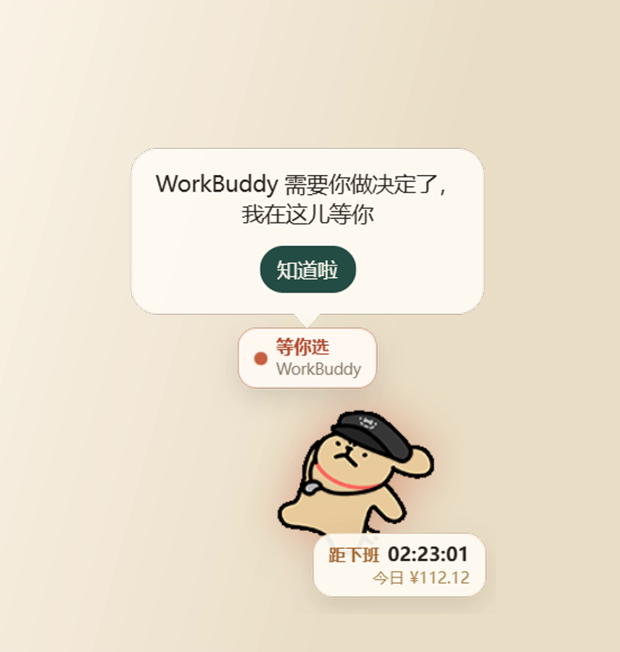
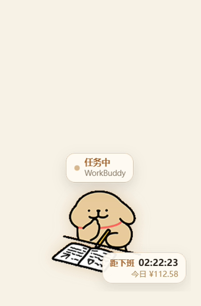
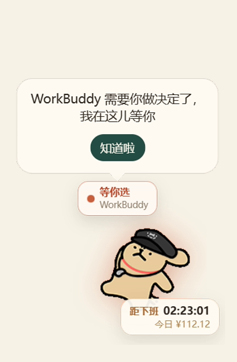

<div align="center">
  

  <h1>小鸡毛桌宠</h1>

  <p><b>一只能看下班倒计时的桌宠，顺便告诉你 AI 干完活了没。</b></p>

  <p>常驻桌面 · 不抢焦点 · 数据全在本机</p>

  <p>
    <a href="../../releases/latest"></a>
    <a href="CHANGELOG.md"></a>
    
    <a href="LICENSE"></a>
  </p>
</div>

---

你大概同时开着好几个窗口：WorkBuddy 在跑任务，Qoder 卡在一个确认框上，Trae 刚把代码改完，而你只想快点到 18:30。

以前要盯三处：任务有没有卡住、有没有要你点确认、离下班还有多久。现在都在同一只狗身上——它趴在你桌面角落，抬头看一眼就知道。

## 它长这样

| 任务中 | 等你选 |
| --- | --- |
|  |  |
| 狗在写字，右下角挂着「距下班 02:23 · 今日 ¥112」 | 狗戴上帽子举手，气泡问你要不要点确认 |

## 功能

### 打工人时钟（主线）

- **距下班倒计时**：扣掉午休，跨天和跨午休都算得对
- **今日已赚**：按你的月薪和计薪方式实时折算，摸鱼时看一眼还挺解压
- **打卡下班**：点一下冻结今天的工时和收入，之后不再跳动
- **加班计时**：过了下班点继续待着，按倍数提醒你该走了
- **四类提醒**：上班、下班、整点、加班，系统通知 + 狗子喊你

### AI 任务状态（加分项）

桌宠会跟着 agent 的任务状态变形：

| 状态 | 桌面表现 | 触发事件 |
| --- | --- | --- |
| 任务中 | 暖色任务牌 + 狗子进入专注姿态 | `UserPromptSubmit` |
| 等你选 | 橙红任务牌 + 狗子举手 + 气泡与系统通知 | `Notification`、`PreToolUse`（AskUserQuestion / ExitPlanMode） |
| 已完成 | 绿牌 + 狗子跳两下 + 完成气泡 | `Stop`、`FinalStop` |

多开、多 agent 并行时按「等你选 > 任务中 > 已完成」取最需要你看的那个，任务牌上显示次数。

### 陪伴

休息提醒、喝水提醒、番茄专注、分心检测（识别到 B 站 / Steam 会喊你）、自定义 GIF 形象。

## 快速开始

到 [Releases](../../releases/latest) 下载 `Setup-x.y.z.exe`，装完双击就能用；设置里可以勾选开机自启。

<details>
<summary>从源码跑</summary>

```bash
corepack pnpm@11.1.1 install
corepack pnpm@11.1.1 dev
```

需要 Node 20+、pnpm 11。打包见文末。
</details>

## 接入 AI agent

设置 →「任务」→ 对应 agent 点「接入」，然后重启那个 agent。按钮只往配置里追加自己的钩子，原有钩子保留，改动前自动备份为 `<配置名>.xiaojimao-<时间>`。

| Agent | 配置文件 | 执行方式 |
| --- | --- | --- |
| WorkBuddy | `~/.workbuddy/settings.json` | Git Bash |
| Qoder | `~/.qoder/settings.json` | PowerShell |
| Trae | `~/.trae-cn/hooks.json` | PowerShell |
| DeepSeek Harness | `cordis.patch.yml` + 桥接插件 | Cordis 插件（见 [`integrations/dsh-bridge`](integrations/dsh-bridge/README.md)） |

前三家设置页点「接入」即可；DeepSeek Harness 没有钩子配置文件，走的是 Cordis 插件：
把 `integrations/dsh-bridge` 放进 dsh 的 profile，在 `cordis.patch.yml` 加两行，重启 dsh。

原理很轻：钩子只做一件事——把事件 JSON 落到 `~/.xiaojimao/workbuddy-events/<Agent>/`，桌宠每 0.8 秒消费一批并删掉。不监听端口、不申请权限、不联网。

只要某个 agent 支持 Claude 风格 hooks（`UserPromptSubmit` / `PreToolUse` / `Notification` / `Stop`），就能接进来，欢迎 PR 补一家。

## 打包

```bash
# 1. 免安装目录（dist/win-unpacked）
corepack pnpm@11.1.1 dist:win

# 2. 补图标与版本信息（版本号读自 package.json）
corepack pnpm@11.1.1 reicon
```

`dist:win` 带 `--config.win.signAndEditExecutable=false`，所以图标 / 版本信息要靠 `reicon` 补写；NSIS 安装包由 `corepack pnpm@11.1.1 dist` 或 CI 的 release 流水线产出。

### 装到固定目录（可选）

如果把成品放到固定目录再建快捷方式，更新时镜像过去即可：

```powershell
robocopy "dist\win-unpacked" "D:\Software\小鸡毛桌宠" /MIR
```

## 目录

```
src/shared/workClock.ts            上下班计算（倒计时 / 午休 / 加班 / 工资），移植自 OffWorkNow
src/shared/workbuddy.ts            agent 事件 → 三态聚合（纯函数，带单测）
src/main/workbuddyHooks.ts         各家 agent 钩子的安装 / 移除 / 检测
src/main/main.ts                   提醒调度、气泡、窗口与托盘
src/renderer/.../PetView.tsx       宠物窗口、任务牌与倒计时徽标
src/renderer/.../SettingsView.tsx  设置页
pet_assets/                        宠物素材
_ref/                              OffWorkNow 参考源码，仅对照，不参与构建
```

## 已知边界

- 模型只用文字提问、不调用询问工具时，钩子只能看到 `Stop`，会显示「已完成」；「等你选」靠询问工具与通知事件识别
- 任务刚起步时宿主会发一条提示通知，这条会被过滤掉（2.5 秒内、无明确类型的通知不算求助）
- Trae 需要在它自己的 Hooks 设置里打开开关
- 目前只做了 Windows

## 致谢

基于 [PawPal](https://github.com/zebangeth/PawPal) v0.3.1（MIT）改造：宠物框架、休息/喝水/专注提醒与分心检测来自原作者。
上下班工时模型移植自 OffWorkNow。宠物素材「小鸡毛」为作者自有。

协议 MIT，宠物素材版权见 [ASSET_LICENSE.md](./ASSET_LICENSE.md)。
